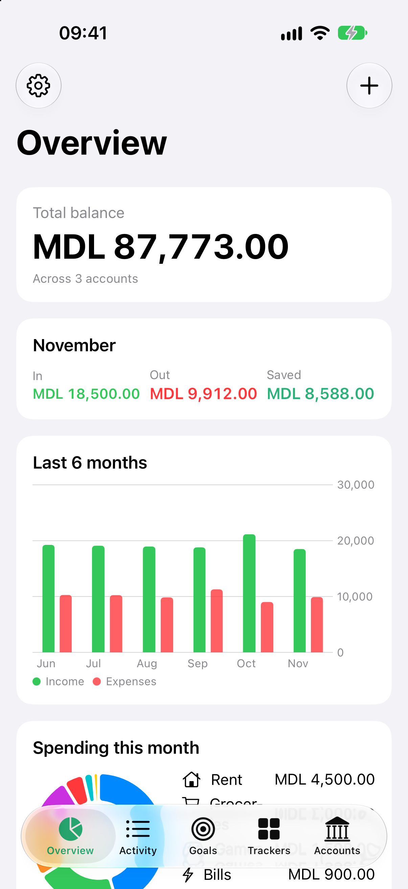
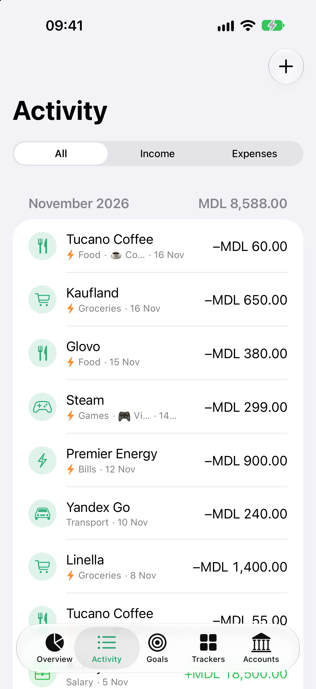
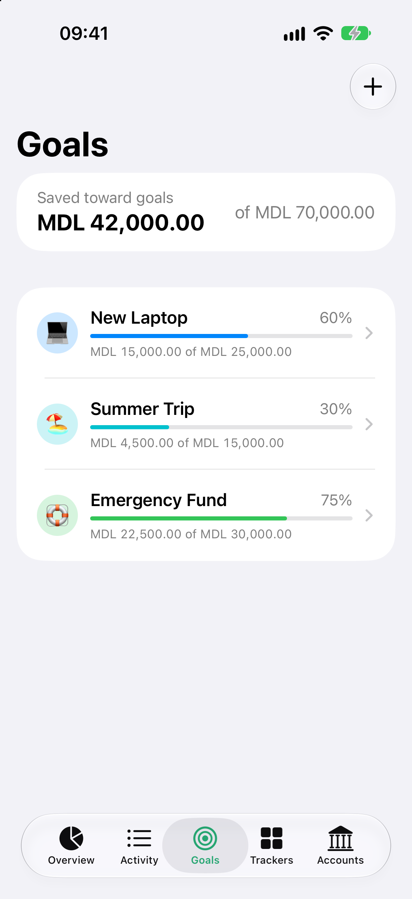
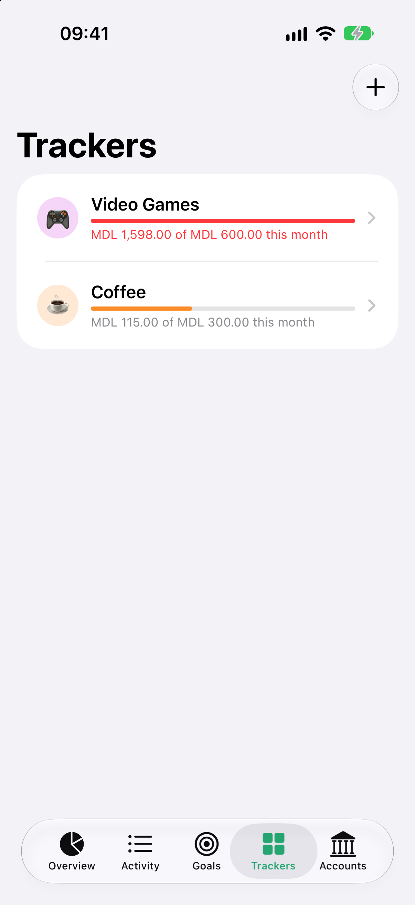
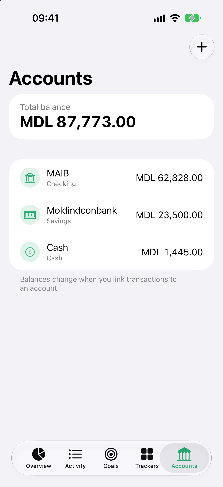

# Savings

Aplicație iOS personală pentru a ține evidența banilor: venituri, cheltuieli, conturi, obiective de economisire și secțiuni proprii (de exemplu 🎮 Video Games). Plățile făcute cu **Apple Pay se înregistrează automat** printr-o automatizare din Shortcuts.

Scrisă în **SwiftUI**, cu date salvate local prin **SwiftData** și grafice cu **Swift Charts**. Nu are server și nu are dependențe externe.

<p align="center">
  
  
  
  
  
</p>

## Funcționalități

| Ecran | Ce face |
|---|---|
| **Overview** | Soldul total, intrările/ieșirile/economiile lunii curente, grafic venituri vs. cheltuieli pe 6 luni și diagramă cu cheltuielile pe categorii |
| **Activity** | Toate tranzacțiile grupate pe luni, cu căutare și filtru. Glisezi spre dreapta pentru editare, spre stânga pentru ștergere |
| **Goals** | Obiective de economisire cu progres, istoric de depuneri/retrageri, termen limită și suma necesară pe lună |
| **Trackers** | Secțiuni create de tine pentru cheltuieli specifice, cu buget lunar opțional și avertizare când îl depășești |
| **Accounts** | Conturi (curent, economii, numerar, card de credit…). Soldul se actualizează din tranzacțiile legate de cont |
| **Settings** ⚙️ | Moneda (implicit MDL), contul implicit pentru plăți automate, backup, restaurare și export CSV |

### Înregistrare automată a plăților Apple Pay

Aplicația oferă acțiunea **Log Expense** pentru Shortcuts. O automatizare de tip *Tranzacție* o rulează după fiecare plată cu Apple Pay, iar aplicația:

- salvează plata cu suma și comerciantul;
- **ghicește categoria** după numele comerciantului (Linella → Groceries, Steam → Games, Glovo → Food, Orange → Bills etc.; lista e în [`AutoLog.swift`](SavingsTracker/Shared/AutoLog.swift));
- o pune în **trackerul** care are aceeași categorie implicită;
- o leagă de **contul** al cărui nume apare în numele cardului (contul „MAIB” pentru cardul „MAIB Visa”). Dacă niciun nume nu se potrivește, folosește contul implicit din Setări;
- o marchează cu ⚡ în Activity, ca să poți verifica ce s-a adăugat automat.

**Configurare (o singură dată, pe iPhone):**

1. **Shortcuts → Automatizare → + → Tranzacție**. Alege *Orice card* și pornește *Automatizare* (rulare imediată).
2. Adaugă acțiunea **Log Expense** din aplicația Savings.
3. Leagă câmpurile de variabila *Tranzacție*:
   - **Amount** → *Valoare*
   - **Merchant** → *Comerciant*
   - **Card** → *Card sau tichet*

> Funcționează doar pentru plățile făcute cu Apple Pay (telefon sau ceas). Plățile cu cardul fizic nu declanșează automatizarea.

### Backup

În **Settings** poți salva un backup complet (`.json`) în Files sau iCloud Drive și îl poți restaura oricând. Exportul **CSV** se deschide în Numbers, Excel sau Google Sheets.

## Instalare pe iPhone

Ai nevoie de un Mac cu **Xcode 26** sau mai nou. Aplicația merge pe **iOS 18+**.

1. Deschide `SavingsTracker.xcodeproj` în Xcode.
2. În **Settings → Accounts**, adaugă Apple ID-ul tău.
3. Conectează iPhone-ul, alege-l sus ca destinație și apasă **⌘R**.
4. Prima dată, pe iPhone: **Settings → General → VPN & Device Management → Trust**.

Cu un cont Apple gratuit, aplicația trebuie reinstalată la fiecare **7 zile**. Datele rămân pe telefon. Cu Apple Developer Program (99 $/an), aplicația merge un an între reinstalări.

## Structura proiectului

```
SavingsTracker/
├── SavingsTrackerApp.swift      Pornirea aplicației și tab-urile
├── Models/
│   └── Models.swift             Account, LedgerEntry, Tracker, SavingsGoal, GoalDeposit
├── Shared/
│   ├── AutoLog.swift            Acțiunea Log Expense pentru Shortcuts și regulile de categorii
│   ├── Backup.swift             Backup, restaurare și export CSV
│   ├── Helpers.swift            Formatare bani, culori, categorii, componente comune
│   └── SampleData.swift         Date demo (doar în build-urile Debug)
└── Views/
    ├── Overview/                Ecranul principal și graficele
    ├── Transactions/            Lista de tranzacții și formularul
    ├── Goals/                   Obiective, depuneri
    ├── Trackers/                Secțiuni personalizate
    ├── Accounts/                Conturi
    └── SettingsView.swift       Monedă, cont implicit, backup
```

## Pentru dezvoltare

- Modelele respectă regulile CloudKit (valori implicite peste tot, relații opționale), deci sincronizarea prin iCloud se poate porni mai târziu adăugând capability-ul **iCloud** (necesită cont plătit de developer).
- În Debug, aplicația acceptă argumente la pornire:
  - `-sampleData` umple o bază de date goală cu date demo;
  - `-tab N` deschide direct tab-ul N (0 = Overview … 4 = Accounts).

  Capturile de mai sus au fost făcute așa:
  ```sh
  xcrun simctl launch booted com.cara.SavingsTracker -sampleData -tab 2
  ```
