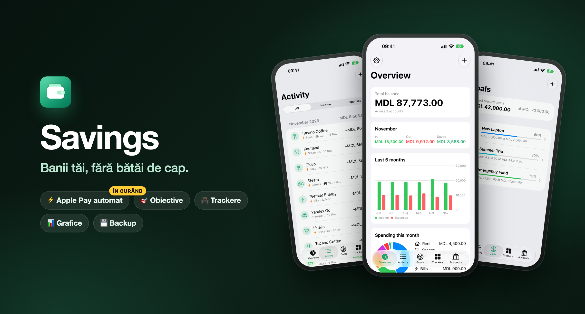
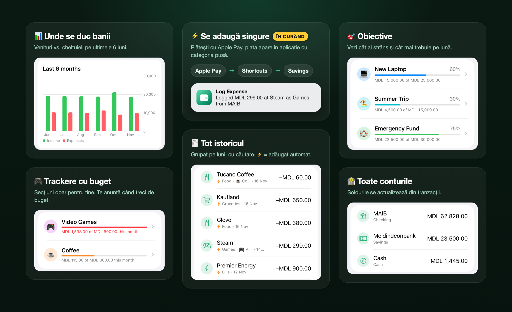

O aplicație iOS simplă pentru banii tăi: vezi cât intră, cât iese, cât ai pus deoparte și pe ce se duc banii. Toate conturile tale stau într-un singur loc, iar în curând și plățile cu Apple Pay se vor adăuga singure.

## Toate conturile tale, într-un singur loc

Ai card la o bancă, economii la alta și ceva cash în buzunar? Le adaugi pe toate în **Accounts** și le urmărești deodată:

- fiecare cont are soldul lui, actualizat din tranzacțiile pe care le adaugi;
- pe **Overview** vezi soldul total, adunat din toate conturile;
- la fiecare cheltuială sau venit alegi din ce cont a fost, ca să știi mereu unde sunt banii.

## Ce poate

- **Overview**: soldul total, luna curentă dintr-o privire, venituri vs. cheltuieli pe ultimele 6 luni și pe ce categorii cheltui cel mai mult.
- **Activity**: toate tranzacțiile, grupate pe luni, cu căutare și filtre.
- **Goals**: obiective de economisire (laptop, vacanță, fond de urgență) cu progres și cât trebuie să pui deoparte lunar ca să ajungi la timp.
- **Trackers**: secțiuni făcute de tine pentru ce vrei să urmărești, gen 🎮 jocuri sau ☕️ cafea, cu buget lunar opțional.
- **Accounts**: toate conturile la un loc, cu soldul actualizat din tranzacții.
- **Sfaturi săptămânale**: în fiecare săptămână vezi cum a mers față de o săptămână obișnuită, ce categorii au sărit, cât poți cheltui pe zi ca să-ți atingi planul de economii și cât trebuie să pui deoparte pentru fiecare obiectiv. Opțional, primești și o notificare.
- **Intro și plan personal**: la prima pornire, aplicația îți arată ce poate și te ajută să-ți setezi venitul, cât vrei să economisești, primul cont și primul obiectiv.
- **Ajutor oricând**: butonul **?** din colțul fiecărui ecran deschide ghiduri scurte, cu animații care îți arată pas cu pas cum faci lucrurile.
- **Backup & export**: backup complet pe care îl poți restaura oricând, plus export CSV pentru Excel / Numbers / Google Sheets.

## Plăți automate cu Apple Pay · în curând

> 🚧 **În dezvoltare.** Funcția e încă în lucru și va fi disponibilă în curând.

După fiecare plată cu Apple Pay, o automatizare din Shortcuts va trimite plata în aplicație. Aplicația:

- recunoaște magazinul și pune singură categoria (Linella → Groceries, Steam → Games, Glovo → Food…);
- o bagă în trackerul potrivit;
- scade suma din contul cardului cu care ai plătit;
- o marchează cu ⚡, ca să știi ce s-a adăugat automat.

> Merge doar cu Apple Pay (telefon sau ceas). Cu cardul fizic, automatizarea nu pornește.

## Tech

SwiftUI · SwiftData · Swift Charts · App Intents. Nu are server, nu are dependențe externe, totul stă pe telefon.
